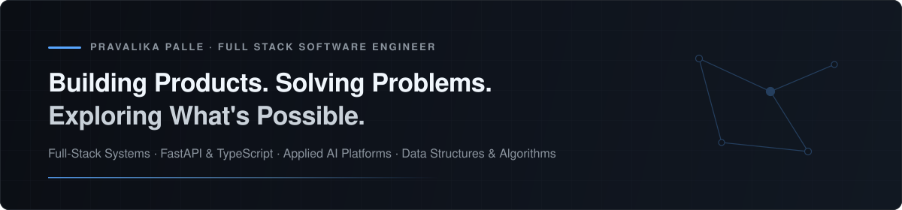

 

**Software Engineer &nbsp;|&nbsp; Full Stack Developer &nbsp;|&nbsp; AI Systems Builder**

I build reliable full-stack applications, backend APIs, and applied AI interfaces using Python, TypeScript, React, and FastAPI—paired with steady practice in Data Structures and Algorithms.

 

## About Me

- **Education:** Master of Computer Applications (MCA), completed 2026.
- **Current Role:** Full Stack Software Engineer Intern at **Agile Receivables**, working on full-stack features, PostgreSQL data models, and FastAPI services.
- **Engineering Focus:** Designing practical software products, clean REST APIs, interactive TypeScript/React interfaces, and applied AI workflows with Google Gemini.
- **Problem Solving:** Practising Data Structures and Algorithms consistently in Python, with an emphasis on reusable problem-solving patterns and clean complexity analysis.

## Tech Stack

<table>
  <tr>
    <td width="190" valign="top"><strong>Languages</strong></td>
    <td>
      
      
      
      
    </td>
  </tr>
  <tr>
    <td valign="top"><strong>Frontend</strong></td>
    <td>
      
      
      
      
      
    </td>
  </tr>
  <tr>
    <td valign="top"><strong>Backend</strong></td>
    <td>
      
      
      
    </td>
  </tr>
  <tr>
    <td valign="top"><strong>Databases &amp; Cache</strong></td>
    <td>
      
      
      
      
    </td>
  </tr>
  <tr>
    <td valign="top"><strong>AI &amp; ML</strong></td>
    <td>
      
      
    </td>
  </tr>
  <tr>
    <td valign="top"><strong>Cloud &amp; Tooling</strong></td>
    <td>
      
      
      
      
      
      
    </td>
  </tr>
</table>

## Featured Projects

<table>
  <tr>
    <td width="50%" valign="top">
      <h3>SynapseIQ</h3>
      
Executive decision intelligence interface transforming business datasets into explainable insights, forecasts, and structured reports using Google Gemini.

      

      
<strong>Stack:</strong> React 19, TypeScript, Vite, Tailwind CSS, React Flow, Recharts, Zustand, Google Gemini API

      

        <a href="https://github.com/pravalika2307/SynapseIQ">Repository</a> &nbsp;·&nbsp;
        <a href="https://synapseiq-os.vercel.app/">Live Demo</a>
      

    </td>
    <td width="50%" valign="top">
      <h3>GraphScope</h3>
      
Engineering dependency intelligence platform powered by CognoDB/Neo4j to explore microservice topologies, trace dependencies, and analyze blast radius.

      

      
<strong>Stack:</strong> React, TypeScript, Tailwind CSS, React Flow, FastAPI, Python, Neo4j / CognoDB

      

        <a href="https://github.com/pravalika2307/GraphScope">Repository</a> &nbsp;·&nbsp;
        <a href="https://graphscope-app.vercel.app/">Live Demo</a>
      

    </td>
  </tr>
  <tr>
    <td width="50%" valign="top">
      <h3>HRlytics AI</h3>
      
Workforce cost intelligence dashboard and conversational HR copilot that attributes calendar overhead to projects using FastAPI and SQLite.

      
<strong>Stack:</strong> React, JavaScript, Vite, Recharts, Framer Motion, FastAPI, SQLAlchemy, SQLite, Google Gemini

      

        <a href="https://github.com/pravalika2307/HRlytics-AI">Repository</a> &nbsp;·&nbsp;
        <a href="https://hrlytics-ai.vercel.app/">Live Demo</a>
      

    </td>
    <td width="50%" valign="top">
      <h3>TalentEval (talent-lens)</h3>
      
Explainable AI candidate ranking system combining semantic scoring and Valkey in-memory caching behind a FastAPI service.

      
<strong>Stack:</strong> Python, FastAPI, Valkey / Redis, scikit-learn, pandas, Docker, HTML/CSS

      

        <a href="https://github.com/pravalika2307/talent-lens">Repository</a> &nbsp;·&nbsp;
        <a href="https://talentlens-inky.vercel.app/">Live Demo</a>
      

    </td>
  </tr>
  <tr>
    <td width="50%" valign="top">
      <h3>Shortest Path Visualizer</h3>
      
Interactive grid pathfinding tool comparing BFS, Dijkstra, and A* algorithms with SQLite run-history persistence.

      

      
<strong>Stack:</strong> Python, Streamlit, SQLite, Pandas, NumPy

      

        <a href="https://github.com/pravalika2307/Shortest-Path-Visualizer">Repository</a>
      

    </td>
    <td width="50%" valign="top">
      <h3>Developer Portfolio</h3>
      
Personal engineering portfolio showcasing full-stack systems, applied AI projects, and an interactive Three.js WebGL system topology.

      
<strong>Stack:</strong> React 19, JavaScript, Vite, Tailwind CSS v4, Three.js, Framer Motion

      

        <a href="https://github.com/pravalika2307/Portfolio">Repository</a> &nbsp;·&nbsp;
        <a href="https://pravalikapalle.vercel.app/">Live Site</a>
      

    </td>
  </tr>
</table>

## My DSA Journey

Started consistent Data Structures and Algorithms practice in **May 2026**, using **Python** as my primary language with a focus on pattern recognition, optimal complexity, and edge-case testing.

- **Primary Repository:** [`pravalika2307/LeetCode-DSA-Journey`](https://github.com/pravalika2307/LeetCode-DSA-Journey)
- **Historical Practice Set:** 103 core problems consolidated from independent notebook practice across 6 foundational patterns, expanded with 115 additional pattern-reinforcing problems (218 unique Python `class Solution` files with unit tests).

| # | Topic / Pattern | Status | Repository Link |
| :---: | :--- | :--- | :--- |
| 1 | Arrays & Matrix | Covered | [`01_Arrays/`](https://github.com/pravalika2307/LeetCode-DSA-Journey/tree/main/01_Arrays) |
| 2 | Hashing | Covered | [`03_Hashing/`](https://github.com/pravalika2307/LeetCode-DSA-Journey/tree/main/03_Hashing) |
| 3 | Two Pointers | Covered | [`04_Two_Pointers/`](https://github.com/pravalika2307/LeetCode-DSA-Journey/tree/main/04_Two_Pointers) |
| 4 | Sliding Window | Covered | [`05_Sliding_Window/`](https://github.com/pravalika2307/LeetCode-DSA-Journey/tree/main/05_Sliding_Window) |
| 5 | Binary Search | Covered | [`06_Binary_Search/`](https://github.com/pravalika2307/LeetCode-DSA-Journey/tree/main/06_Binary_Search) |
| 6 | Linked Lists | Covered | [`07_Linked_List/`](https://github.com/pravalika2307/LeetCode-DSA-Journey/tree/main/07_Linked_List) |
| 7 | Stack & Queue | Upcoming | [`08_Stack_Queue/`](https://github.com/pravalika2307/LeetCode-DSA-Journey/tree/main/08_Stack_Queue) |
| 8 | Trees | Upcoming | [`09_Trees/`](https://github.com/pravalika2307/LeetCode-DSA-Journey/tree/main/09_Trees) |
| 9 | Heap | Upcoming | [`10_Heap/`](https://github.com/pravalika2307/LeetCode-DSA-Journey/tree/main/10_Heap) |
| 10 | Backtracking | Upcoming | [`11_Backtracking/`](https://github.com/pravalika2307/LeetCode-DSA-Journey/tree/main/11_Backtracking) |
| 11 | Graphs | Upcoming | [`12_Graphs/`](https://github.com/pravalika2307/LeetCode-DSA-Journey/tree/main/12_Graphs) |
| 12 | Dynamic Programming | Upcoming | [`13_Dynamic_Programming/`](https://github.com/pravalika2307/LeetCode-DSA-Journey/tree/main/13_Dynamic_Programming) |
| 13 | Greedy | Applied in Arrays/Two Pointers · Dedicated Folder Upcoming | [`14_Greedy/`](https://github.com/pravalika2307/LeetCode-DSA-Journey/tree/main/14_Greedy) |
| 14 | Bit Manipulation | Applied in Arrays & Hashing (XOR patterns) | [`Progress/pattern_tracker.md`](https://github.com/pravalika2307/LeetCode-DSA-Journey/blob/main/Progress/pattern_tracker.md) |

## GitHub Statistics

 

 

## Currently Focusing On

- Building reliable full-stack applications with **React, TypeScript, Next.js, and FastAPI**
- Designing practical **AI-powered workflows** with structured outputs and evaluation
- Strengthening **backend engineering, PostgreSQL data modeling, and cloud deployment**
- Advancing **Python DSA** into Stacks, Queues, Trees, Graphs, and Dynamic Programming
- Writing clean, testable, maintainable production code

## Connect With Me

